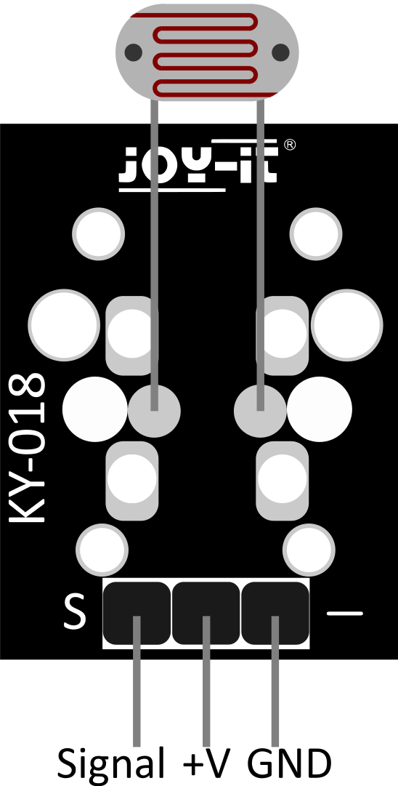

# Demo de energia con Zephyr

Demo para la `NUCLEO-WL55JC1` y un fotoresistor `KY-018`. Lee la luz por el
ADC, muestra el resultado por el puerto serie y permite cambiar la politica de
energia con los tres botones de la placa.

No utiliza BLE, LoRa, radio ni LED. Siempre se realizan las mismas ocho
conversiones ADC cada 5000 ms. Lo unico que cambia es el estado mas profundo
que la aplicacion permite elegir a la politica de energia de Zephyr. Cada muestra imprime
tambien cuantas veces ha entrado el sistema en STOP0, STOP1 y STOP2, para poder
ver la decision de la politica y no solo suponerla.

## Cableado

El KY-018 contiene una LDR y una resistencia `103` de 10 kohm. Su salida `S`
es analogica y no necesita componentes externos adicionales.




| KY-018 | NUCLEO-WL55JC1 |
|---|---|
| `-` | `GND` |
| `+` | `3V3` |
| `S` | `A0`, que corresponde a PB1/ADC1_IN5 |

Con la LDR hacia arriba, como en la imagen, los pines son `S`, `+` y `-` de
izquierda a derecha. Como existen copias con serigrafia incorrecta, conviene
comprobarlo antes con un multimetro. Alimente siempre el modulo con 3.3 V y
verifique que `S` permanece entre 0 y 3.3 V. No use 5 V.

## Botones

Los botones fijan el estado mas profundo que la politica puede elegir. La
aplicacion no define modos propios: usa los estados de Zephyr y los bloquea con
`pm_policy_state_lock_get()`. El firmware arranca sin bloqueos, como Zephyr por
defecto (hasta STOP2), y el limite cambia sin reiniciar ni volver a flashear:

| Boton | Efecto |
|---|---|
| `B1/SW1` | `active`: sin STOP. Linea base para medir corriente |
| `B2/SW2` | barrido: cada pulsacion pasa al siguiente limite, STOP0 -> STOP1 -> STOP2 -> STOP0. Desde `active` empieza en STOP0 |
| `B3/SW3` | sin uso (no se configura su interrupcion) |

Locks de Zephyr que quedan tomados con cada limite:

| Limite | Locks |
|---|---|
| `active` | substates 1, 2 y 3 |
| hasta STOP0 (`suspend-to-idle`/1) | substates 2 y 3 |
| hasta STOP1 (`suspend-to-idle`/2) | substate 3 |
| hasta STOP2 (`suspend-to-idle`/3) | ninguno |

Los locks de Zephyr son contadores: cada `get` necesita su `put`. Al cambiar de
limite solo se suelta lo que deja de estar bloqueado y se toma lo que pasa a
estarlo, asi que nunca se acumulan bloqueos.

Las pulsaciones a menos de 200 ms de la anterior se ignoran. Un boton mecanico
rebota y genera varios flancos por pulsacion; sin ese filtro, una sola
pulsacion de B2 podria avanzar varios pasos del barrido.

## Estados de energia

Zephyr define estados genericos (`enum pm_state`); cada SoC declara en el
Devicetree cuales tiene y como se llaman en su hardware. En el STM32WL
(`dts/arm/st/wl/stm32wl.dtsi`):

| Modo ST | Estado Zephyr | `substate-id` | `min-residency-us` |
|---|---|---|---|
| STOP0 | `suspend-to-idle` | 1 | 100 |
| STOP1 | `suspend-to-idle` | 2 | 500 |
| STOP2 | `suspend-to-idle` | 3 | 900 |

Standby y Shutdown de ST no estan declarados, asi que Zephyr nunca los usa.
Ojo: el estado `standby` de Zephyr no es el Standby de ST.

Mientras `main` duerme, el hilo idle pide a la politica un estado. La politica
por defecto elige el mas profundo cuya residencia minima cabe en el tiempo
hasta el siguiente timeout y que no este bloqueado. El sistema despierta por
LPTIM1, el tick de bajo consumo que sigue funcionando en STOP, o por un boton
(EXTI).

Contadores medidos en la placa, por muestra:

| Limite | Intervalo | STOP0 | STOP1 | STOP2 |
|---|---|---|---|---|
| hasta STOP2 (arranque) | 5000 ms | 0 | 0 | 4 |
| hasta STOP1 | 5000 ms | 0 | 4 | 0 |
| hasta STOP0 | 5000 ms | 4 | 0 | 0 |
| hasta STOP2 | 1000 ms | 0 | 0 | 1 |
| hasta STOP0 | 1000 ms | 1 | 0 | 0 |
| `active` | 1000 ms | 0 | 0 | 0 |

Con 5000 ms hay varias entradas por muestra porque el LPTIM no puede programar
un sueno tan largo: es un contador de 16 bits y con
`CONFIG_STM32_LPTIM_TIMEBASE=0xF9FF` a 32 kHz su maximo es 2 s
(`drivers/timer/stm32_lptim_timer.c`). El kernel despierta al menos cada 2 s
para reprogramarlo, y cada despertar es una entrada mas en STOP. Eso explica 3
entradas; la cuarta no esta analizada.

La primera muestra tras el arranque muestra ceros porque todavia no se ha
dormido ninguna vez. La muestra justo despues de pulsar un boton mezcla el
limite anterior y el nuevo.

## Experimento de residencia

Con `CONFIG_DEMO_SLEEP_SLICE_US` distinto de 0, `main` duerme a tramos cortos
en lugar de una sola vez. La politica solo ve el tramo, no el segundo
completo, y tiene que elegir estados menos profundos:

```sh
west build -b nucleo_wl55jc . -d build-750 -- \
  -DBOARD_FLASH_RUNNER=openocd -DCONFIG_DEMO_SLEEP_SLICE_US=750
```

Entradas por segundo medidas sin limite (hasta STOP2):

| Tramo | STOP0 | STOP1 | STOP2 |
|---|---|---|---|
| 0 (un solo sueno) | 0 | 0 | 1 |
| 250 us | ~990 | ~990 | 0 |
| 500 us | ~390 | ~1195 | 0 |
| 750 us | 0 | ~660 | ~660 |
| 1000 us | 0 | ~420 | ~715 |

El tick de esta placa es de 250 us (`CONFIG_SYS_CLOCK_TICKS_PER_SEC=4000`).
`K_USEC` redondea hacia arriba a ticks (`Z_TIMEOUT_US`, `sys/clock.h`) y un
timeout relativo anade un tick mas para garantizar la espera minima
(`kernel/timeout.c`). Por eso un mismo tramo no corresponde a un solo estado:
el tiempo que ve la politica depende de en que punto del tick empieza el
sueno. El reparto exacto entre estados no esta analizado.

## Compilar y flashear

Entorno utilizado:

- Zephyr `4.4.2`.
- Board `nucleo_wl55jc`.
- Zephyr SDK `1.0.1`.

Desde PowerShell, en la raiz del proyecto:

```powershell
.\scripts\build.ps1
.\scripts\flash.ps1
```

Tambien estan disponibles las tareas `Demo: Build`, `Demo: Flash` y
`Serial Monitor` en VS Code.

En Linux, dentro del entorno con `west`, estan las tareas `Linux: Build` y
`Linux: Flash`, o directamente:

```sh
west build -b nucleo_wl55jc . -- -DBOARD_FLASH_RUNNER=openocd
west flash --cmd-pre-init "reset_config srst_only srst_nogate connect_assert_srst"
```

El `--cmd-pre-init` hace falta porque este firmware pasa casi todo el tiempo
en STOP2, donde el puerto de depuracion no responde. Con `connect_assert_srst`
OpenOCD mantiene el reset mientras se conecta, igual que `mode=UR` en
STM32CubeProgrammer.

El monitor serie utiliza `115200 8N1`. Una ejecucion normal se ve asi:

```text
Permitido: hasta suspend-to-idle/3 (STOP2)
App iniciada
B1: active; B2: barrido STOP0 -> STOP1 -> STOP2; B3: sin uso
Intervalo: 5000 ms; tramo de sueno: 0 us; ADC: A0/PB1
Muestra 1: 1218 | STOP0 0 STOP1 0 STOP2 0
Muestra 2: 1328 | STOP0 0 STOP1 0 STOP2 4
```

Al iluminar y tapar la LDR, los valores deben cambiar. Cada pulsacion imprime
el nuevo limite y las muestras continuan apareciendo.

## Medicion de corriente

El puente `JP1`, rotulado `I_SoC`, permite medir en serie la corriente del
STM32WL. Esa medida no incluye toda la placa, el ST-LINK ni el KY-018.

Con la placa sin alimentacion:

1. Retire el jumper JP1.
2. Configure el multimetro para corriente continua.
3. Conecte el amperimetro entre los dos pines de JP1.
4. Vuelva a alimentar la placa.

El amperimetro sustituye al jumper y debe permanecer conectado. Nunca lo
conecte directamente entre 3V3 y GND.

Todo el consumo del STM32 pasa por la resistencia interna del amperimetro, y
la caida de tension en ella se resta de la alimentacion. En la escala de uA esa
resistencia es alta: los pocos mA del arranque o de cada despertar pueden bajar
VDD por debajo del umbral de brown-out. Sintoma: el ST-LINK sigue midiendo
3.3 V, pero no hay salida serie y no se puede flashear. Para flashear y
arrancar, use la escala de mA o vuelva a poner JP1.

Para comparar limites, pulse y suelte el boton correspondiente y espere unos
segundos antes de leer el multimetro. La consola permanece activa siempre, por
lo que los resultados son comparaciones relativas y no el consumo minimo
absoluto del microcontrolador.

Un multimetro convencional muestra principalmente un promedio y puede no
capturar los pulsos breves de actividad del ADC y la UART.

## Archivos principales

- `src/main.c`: lectura ADC, botones, restricciones de energia y contadores
  de STOP.
- `prj.conf`: configuracion de Zephyr.
- `Kconfig`: intervalo de muestreo y tramo de sueno del experimento.
- `boards/nucleo_wl55jc.overlay`: canal ADC.
- `scripts/build.ps1`: compilacion.
- `scripts/flash.ps1`: flasheo.
